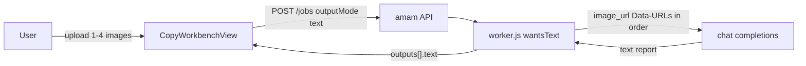

# Click Rate Forecast

Feature Name: click-rate-forecast
Updated: 2026-10-15

## Description

把工具箱 `click-rate`（点击率预测）从 planned 占位接入为文本场景，与 `pre-check-analysis` 同构：任务 `outputMode=text`，worker 调 `generateTextForJob`，把全部主图按顺序以 Data-URL 放进 chat completions 的 user content。前端复用 `CopyWorkbenchView`，图片必传 1-4 张（与 `chatUserContent` 的 4 张上限对齐）。

## Architecture



## Components and Interfaces

### `sceneSchemas.json`

新增 slug `click-rate`：

- `outputMode: "text"`
- roles：`product`（待评估主图，min 1、max 4）
- fields：`platform`（select：all/douyin/tmall/xhs/pdd/jd，默认 all）、`placement`（可选 text）、`goal`（可选 textarea）
- `instruction`：逐张五维诊断（主体吸引力、文字引导、色彩对比、场景氛围、平台适配）+ 点击档位（高/中/低）+ 主推图结论 + 定性评估约束（禁止编造精确百分比与历史 CTR；缺失标待补）

### `CopyWorkbenchView`

- `requireImage` 从 `slug === 'pre-check'` 扩为集合 `['pre-check', 'click-rate']`
- 缺图提示按场景返回：pre-check「请先上传待检测图片」，click-rate「请先上传主图」
- 区块标题与说明按场景切换：「待评估主图」/「可选商品图」

### `router.js`

- 新增 `{ path: 'tools/ai/click-rate', component: CopyWorkbenchView, props: { kind: 'tool', scene: 'click-rate' } }`

### `business.json`

- `click-rate` 条目改 `capability: "implemented"`、`status: "已接入"`、`targetRoute: "/tools/ai/click-rate"`、`kind: "analysis"`

### `server/worker.js`

- `wantsText` 已按 `outputMode === 'text'` 走 `generateTextForJob`，无需改动
- `textOutputsFor` fake 样例增加 `click-rate` 报告样例

## Data Models

任务提交：

```json
{
  "scene": "click-rate",
  "model": "nano-banana",
  "params": { "outputCount": 1, "platform": "douyin", "placement": "信息流", "goal": "大促主图" },
  "refs": [
    { "role": "product", "name": "a.png", "url": "/api/v1/assets/ast_a/file", "assetId": "ast_a" },
    { "role": "product", "name": "b.png", "url": "/api/v1/assets/ast_b/file", "assetId": "ast_b" }
  ]
}
```

结果：`outputs[0].text` 为点击率评估报告，refs 顺序即评估顺序。

## Correctness Properties

1. `click-rate` 契约存在且 `outputMode` 为 `text`，`roles[0]` 为 `min=1`、`max=4`。
2. fake 模式 `click-rate` 返回含「主推图」字样的样例报告。
3. live 模式 `click-rate` 的 chat completions user content 按顺序包含全部图片 `image_url`，prompt 含平台与档位约束。
4. 工作台在无图片时禁用生成按钮。

## Error Handling

- 无图提交被前端禁用；直连 API 缺图时沿用现有任务校验。
- 上游失败沿用 `vendor_error` / `vendor_timeout` / `vendor_empty` 并退款。

## Test Strategy

- 契约测试：`click-rate` slug、`outputMode=text`、图片 min/max、platform 选项齐全。
- fake 任务：创建即完成，`outputs[0].text` 匹配样例关键词。
- live 任务（mock 上游，2 张图）：断言 user content 类型序列 `['text', 'image_url', 'image_url']` 且 prompt 含「投放平台」标签。

## References

- `.monkeycode/specs/pre-check-analysis/`：同构先例
- `server/vendor.js` `generateTextForJob` / `chatUserContent`：识图对话实现（4 张上限）
