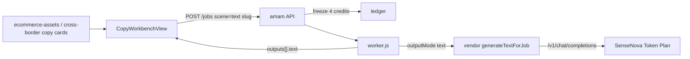

# Copy Text Jobs

Feature Name: copy-text-jobs
Updated: 2026-10-09

## Description

把电商素材的 AI 文案、商品标题，以及跨境 Listing 生成、本地化、合规检测接到现有 Job 管线。Worker 按场景 `outputMode=text` 走对话代调，结果写入 `outputs[].text`。前端使用独立文案工作台，目录卡片进入本场景路径。

## Architecture



图像任务仍走 `generateForJob`。文案任务不写图片资产。

## Components and Interfaces

### 场景契约

在 `src/data/sceneSchemas.json` 追加 5 条，`outputMode` 均为 `text`：

| slug | 主字段 | 可选参考图 |
| --- | --- | --- |
| `ai-copywriting` | `product_info`、`channel`、`tone` | product 0–4 |
| `title-generator` | `product_info`、`platform`、`keywords` | product 0–4 |
| `listing-generate` | `product_info`、`platform`、`marketplace` | product 0–4 |
| `listing-localize` | `source_listing`、`target_language`、`target_country` | product 0–4 |
| `listing-compliance` | `listing_text`、`platform` | product 0–4 |

### 目录

`business.json` 将上述 5 条标为 `implemented` / `已接入`。不设置 `targetRoute`，卡片走 `${category.path}/${slug}`。

### 路由

在 catch-all 之前注册：

- `/ecommerce-assets/ai-copywriting`
- `/ecommerce-assets/title-generator`
- `/cross-border/listing-generate`
- `/cross-border/listing-localize`
- `/cross-border/listing-compliance`

组件均为 `CopyWorkbenchView`。

### 对话代调

`server/vendor.js` 新增 `generateTextForJob(job)`：

- Key：`AMAM_VENDOR_CHAT_API_KEY`，缺省回退到已配置的图像槽 Key
- Base：`AMAM_VENDOR_CHAT_BASE_URL`，缺省回退图像槽 Base 或 `https://token.sensenova.cn/v1`
- Model：`AMAM_VENDOR_CHAT_MODEL`，缺省 `sensenova-6.8-flash-lite`
- POST `{base}/chat/completions`，JSON `messages`，`n` 不使用
- 解析 `choices[0].message.content` 或 SenseNova `data.choices[0].message`

### Worker

`outputMode === 'text'` 时：fake 返回样例文本；live 调 `generateTextForJob`；成功 `outputs: [{ index, text }]`；失败沿用 `vendor_*` 并退款。

### 前端

`CopyWorkbenchView` 复用场景契约字段渲染，结果区展示文本与复制按钮。`SimplePage` 对无 `url` 的产出显示文案占位。

## Data Models

文案成功产出：

```json
{ "index": 0, "text": "标题与卖点正文" }
```

Job 其余字段与图像任务相同。

## Correctness Properties

1. 5 个文案场景契约存在且 `outputMode` 为 `text`。
2. 5 个目录条目为 `implemented`，无 `targetRoute`。
3. fake 文案任务 `outputs[0].text` 非空。
4. live 文案任务只打 `/v1/chat/completions`。
5. live 图像任务不打 `/v1/chat/completions`。

## Error Handling

对话凭证缺失：`vendor_unconfigured`。上游 4xx/5xx：`vendor_error`。超时：`vendor_timeout`。空回复：`vendor_empty`。均退款。

## Test Strategy

扩展 `tests/generation-pipeline.test.js`：契约与目录断言、fake 文本产出、live chat mock、图像任务不走 chat。

## References

- Token Plan chat：`https://token.sensenova.cn/v1/chat/completions`
- 默认对话模型：`sensenova-6.8-flash-lite`
