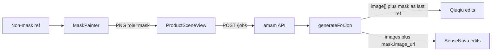

# Mask Paint Edit

Feature Name: mask-paint-edit
Updated: 2026-10-12

## Description

为 5 个已声明可选 `mask` 角色的改图场景补工作台画笔，导出与原图像素对齐的透明 PNG 蒙版，提交为 `refs.role=mask`。`vendor.js` 在 edits 时把蒙版从 `image[]` / `images[]` 拆出，multipart 走字段 `mask`，SenseNova JSON 走 `mask.image_url`。无蒙版时请求体与现网一致。

## Architecture



蒙版可选。空蒙版时 `generateOnce` 只带非蒙版参考图。

## Components and Interfaces

### 覆盖场景

`eliminate-pro`、`local-replace`、`material-apply`、`change-bg`、`product-retouch-pro`

契约已有 `mask` 角色，`min=0`、`max=1`，本规格不新增 slug。

### `MaskPainter`

新组件 `src/components/MaskPainter.vue`：

- 入参：底图 URL
- 操作：画笔、橡皮、笔刷大小、清空、取消、确认
- 导出：与底图相同宽高的 PNG；涂抹处 alpha=0，其余 alpha=255
- 展示画布用半透明红色描边，导出画布使用不透明笔画再做 `destination-out`

### `ProductSceneView`

蒙版角色渲染涂抹入口与上传入口。第一张非蒙版参考图作为底图。确认涂抹后写入 `uploads.mask`，最多 1 张，登录后走现有 `persistLocalItem`。示例条对蒙版角色隐藏。

### `server/vendor.js`

`loadRefImages` 保留 `role`，拆出最多 1 张 `mask` 与最多 8 张非蒙版图。

`multipartBody` 无蒙版时用 `image[]`。球球 Token 有蒙版时仍用 `image[]`，把蒙版作为最后一张参考图，并在提示词中说明透明像素为编辑区域。非球球 multipart 有蒙版时用 `image` 加 `mask`。SenseNova JSON 增加 `mask: { image_url }`。无蒙版时不写该字段。

## Data Models

任务 refs：

```json
[
  { "role": "product", "name": "bag.png", "url": "/api/v1/assets/ast_a/file", "assetId": "ast_a" },
  { "role": "mask", "name": "mask.png", "url": "/api/v1/assets/ast_b/file", "assetId": "ast_b" }
]
```

Multipart edits 字段：无蒙版用 `image[]`；球球 Token 有蒙版仍用 `image[]` 并把蒙版放在最后一张；非球球有蒙版用 `image` 与 `mask`。另含 `model`、`prompt`、`n`、`size`、`response_format`。

SenseNova edits JSON：`images` 仅为非蒙版 Data-URL；`mask.image_url` 为蒙版 Data-URL。

## Correctness Properties

1. 5 个蒙版场景契约的 `mask.min` 为 0。
2. 非球球有蒙版时 multipart 同时出现 `name="image"` 与 `name="mask"`，且不含 `image[]`。球球 Token 有蒙版时只出现 `image[]`，提示词说明透明区域。
3. 有蒙版时 SenseNova `images.length` 等于非蒙版张数，且存在 `mask.image_url`。
4. 无蒙版时请求体不含 mask 字段。

## Error Handling

- 无底图时不打开画笔，工作台提示先上传原图。
- 蒙版上传失败沿用现有 `persistLocalItem` 错误展示。
- 上游失败沿用 `vendor_error` / `vendor_timeout` / `vendor_empty` 并退款。

## Test Strategy

扩展 `tests/generation-pipeline.test.js`：

- `eliminate-pro` live multipart：原图 + 蒙版
- SenseNova live JSON：原图 + 蒙版
- 现有无蒙版 edits 断言保持「无 mask 字段」
- 契约断言 5 个 slug 的 mask 可选

## References

[^1]: `.monkeycode/specs/image-edit-tools/design.md`
[^2]: `server/vendor.js`
[^3]: `src/views/ProductSceneView.vue`
