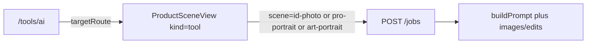

# Portrait Photo Tools

Feature Name: portrait-photo-tools
Updated: 2026-10-10

## Description

为证件照、职业形象照、艺术写真补独立图像契约，目录标已接入，路由接到现有 `ProductSceneView`。沿用图像代调、积分和 Key 边界。投前检测与点击率预测仍停在方案页。

## Architecture

`/tools/ai/:scene` 的方案页 catch-all 保持在专用工作台路由之后。

## Components and Interfaces

### 新契约 slug

`id-photo`、`pro-portrait`、`art-portrait`

### 路由

在 `remove-watermark` 之后为上述 slug 增加 `ProductSceneView` `kind=tool` 路由。

### `business.json` toolbox

上述 3 条：`capability=implemented`，`targetRoute=/tools/ai/{slug}`。`pre-check` 与 `click-rate` 保持 `planned`。

### 契约字段

- `id-photo`：证件规格（一寸 / 二寸 / 护照 / 自定义）、底色（蓝 / 白 / 红）、着装方向
- `pro-portrait`：职业类型、着装正式程度、背景（纯色 / 办公室 / 影棚）
- `art-portrait`：写真风格（杂志 / 胶片 / 油画 / 日系）

提示词要求保留原图人物身份，只改变服装、背景、规格或风格。

## Data Models

每条默认 `maxOutputs=4`，`outputMode=variants`。证件照默认比例 `3:4`，形象照与写真默认 `3:4`。人物照角色 `product` 最少 1 张。场景契约总数 96。

## Correctness Properties

1. 3 个 slug 均存在于 `sceneSchemas.json`。
2. 工具目录对应场景 `sceneRoute` 为 `/tools/ai/{slug}`。
3. `POST /jobs` 接受这些 slug。
4. `pre-check` 与 `click-rate` 仍为 `planned`。

## Test Strategy

扩展 `tests/generation-pipeline.test.js`：创建 3 个 slug 的任务；断言工具目录映射；断言契约总数为 96。

## References

[^1]: `.monkeycode/specs/image-edit-tools/design.md`
[^2]: `src/data/business.json` toolbox
