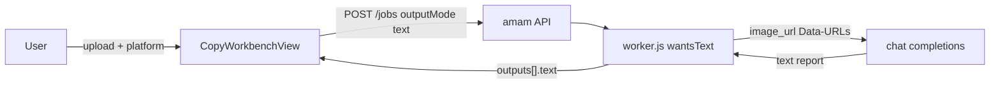

# Pre-check Analysis

Feature Name: pre-check-analysis
Updated: 2026-10-15

## Description

把工具箱 `pre-check`（投前检测）从 planned 占位接入为文本场景。复用对话识图链路：任务 `outputMode=text`，worker 调 `generateTextForJob`，把待检测图片以 Data-URL 放进 chat completions 的 user content。前端复用 `CopyWorkbenchView`，图片从「可选」变为「至少 1 张」。

## Architecture



## Components and Interfaces

### `sceneSchemas.json`

新增 slug `pre-check`：

- `outputMode: "text"`
- fields：`platform`（select：all/douyin/tmall/xhs/pdd/jd，默认 all）、`placement`（可选 text）、`goal`（可选 textarea）
- `instruction` 描述四维检测与报告模板（主体、文字、构图、平台风险；风险等级；逐项建议；缺失标待补）

### `CopyWorkbenchView`

- `kindLabel` 支持 `tool` → 「AI 智能处理」
- `requireImage = schema.slug === 'pre-check'`：`canGenerate` 加 `uploads.length >= 1`，提示「请先上传待检测图片」
- 「可选商品图」区标题按 `requireImage` 切换为「待检测图片」，允许最多 4 张（沿用现有上限）

### `router.js`

- 新增 `{ path: 'tools/ai/pre-check', component: CopyWorkbenchView, props: { kind: 'tool', scene: 'pre-check' } }`

### `business.json`

- `pre-check` 条目改 `capability: "implemented"`、`status: "已接入"`、`targetRoute: "/tools/ai/pre-check"`、`kind: "analysis"`

### `server/worker.js`

- `wantsText` 已按 `outputMode === 'text'` 走 `generateTextForJob`，无需改动
- `textOutputsFor` fake 样例增加 `pre-check` 报告样例

## Data Models

任务提交：

```json
{
  "scene": "pre-check",
  "model": "nano-banana",
  "params": { "outputCount": 1, "platform": "douyin", "placement": "信息流", "goal": "提升点击率" },
  "refs": [{ "role": "product", "name": "ad.png", "url": "/api/v1/assets/ast_x/file", "assetId": "ast_x" }]
}
```

结果：`outputs[0].text` 为检测报告。

## Correctness Properties

1. `pre-check` 契约存在且 `outputMode` 为 `text`。
2. fake 模式 `pre-check` 返回含「主体」「文字」「构图」字样的样例报告。
3. live 模式 `pre-check` 的 chat completions 请求 user content 含图片 `image_url` 且 prompt 含「投放平台」标签。
4. 工作台在无图片时禁用生成按钮。

## Error Handling

- 无图提交被前端禁用；直连 API 缺图时沿用现有任务校验。
- 上游失败沿用 `vendor_error` / `vendor_timeout` / `vendor_empty` 并退款。

## Test Strategy

- 契约测试：`pre-check` slug、`outputMode=text`、platform 选项齐全。
- fake 任务：创建即完成，`outputs[0].text` 匹配样例关键词。
- live 任务（mock 上游）：捕获 chat completions body，断言 user content 数组含图片与平台字段标签。

## References

- `.monkeycode/specs/copy-text-jobs/`：文案任务链路先例
- `server/vendor.js` `generateTextForJob` / `chatUserContent`：识图对话实现
